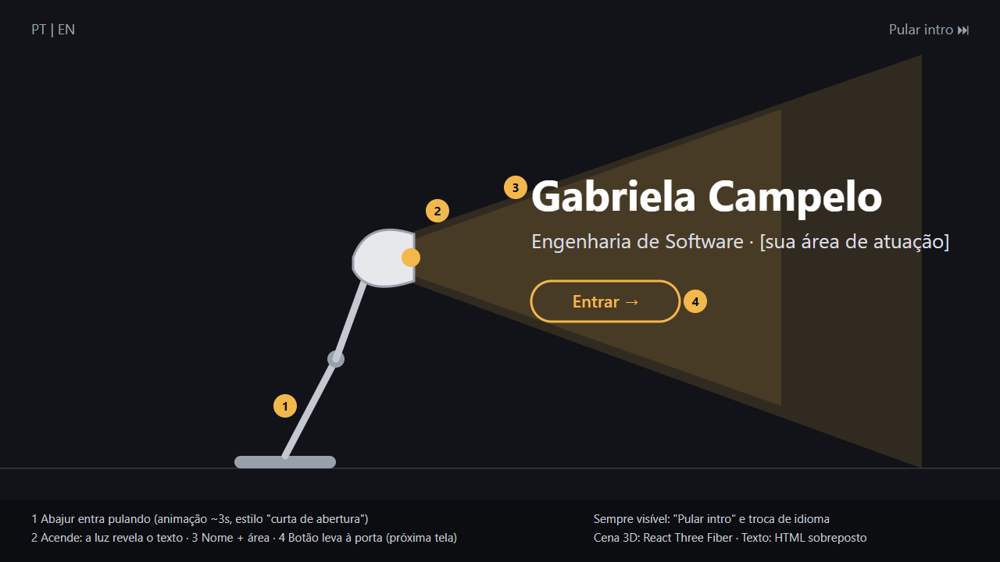
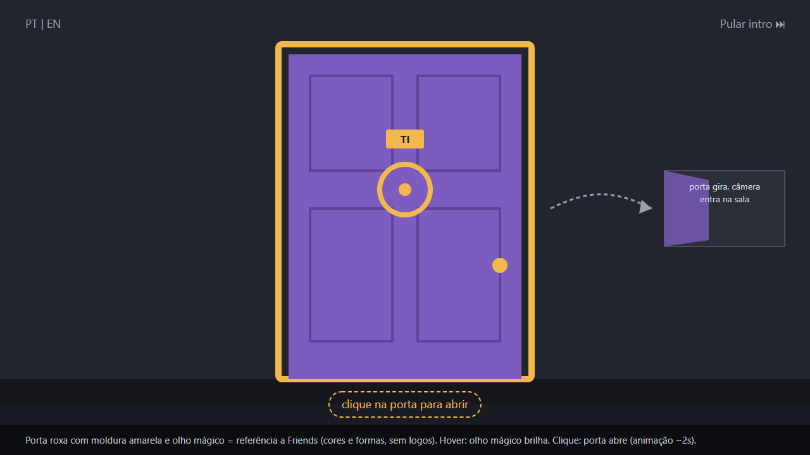
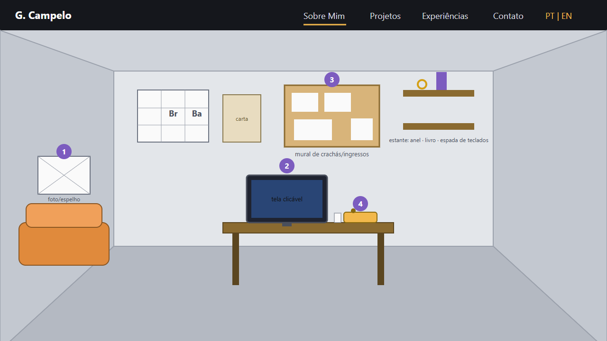
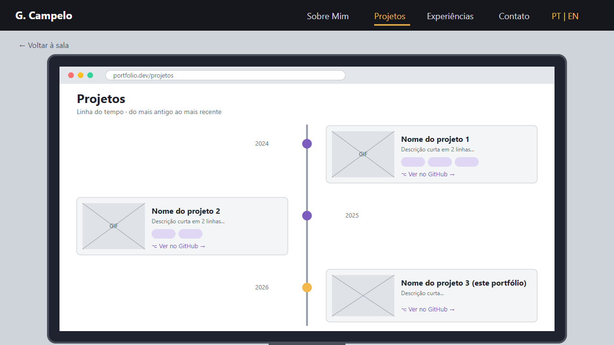
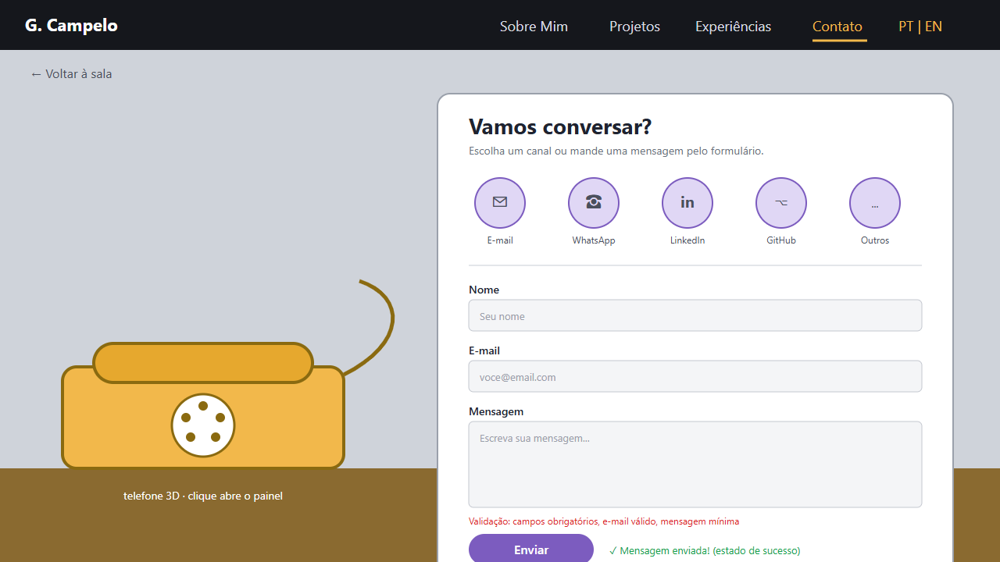
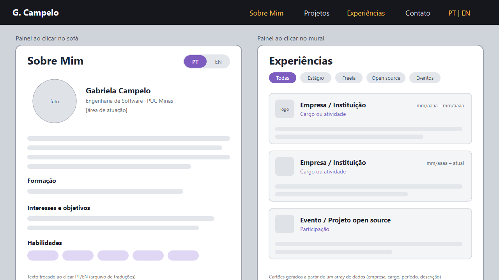

# 💡 Portfólio 3D — Gabriela Campelo

> [!NOTE]
> Portfólio interativo com experiência 3D imersiva, construído com React Three Fiber. Inspirado em referências de séries como Friends, Breaking Bad, Game of Thrones e Senhor dos Anéis.

<table>
  <tr>
    <td width="800px">
      <div align="justify">
        Este projeto é um <b>portfólio profissional interativo</b> desenvolvido para a disciplina <i>DIAW (Desenvolvimento de Interfaces e Aplicações Web)</i> do curso de <b>Engenharia de Software</b> da PUC Minas, ministrada pelo <a href="https://github.com/joaopauloaramuni">Prof. Dr. João Paulo Carneiro Aramuni</a>. O site apresenta uma <b>cena 3D navegável</b> com animação de um abajur estilo Pixar, uma porta inspirada em Friends e uma sala interativa com easter eggs de séries. Cada objeto da sala leva a uma seção do portfólio: <i>Sobre Mim</i>, <i>Projetos</i>, <i>Experiências</i>, <i>Contato</i> e <i>Agenda</i>. O portfólio conta com <b>suporte bilíngue (PT/EN)</b>, <b>formulário funcional com EmailJS</b>, <b>Google Calendar integrado</b> e <b>design responsivo</b>.
      </div>
    </td>
    <td>
      <div>
        
      </div>
    </td>
  </tr>
</table>

---

## 🚧 Status do Projeto

[](https://github.com/gabiscamp/portifolio_campelo/releases)


---

## 📚 Índice
- [Links Úteis](#-links-úteis)
- [Sobre o Projeto](#-sobre-o-projeto)
- [Funcionalidades Principais](#-funcionalidades-principais)
- [Tecnologias Utilizadas](#-tecnologias-utilizadas)
- [Arquitetura](#-arquitetura)
- [Instalação e Execução](#-instalação-e-execução)
- [Estrutura de Pastas](#-estrutura-de-pastas)
- [Demonstração](#-demonstração)
- [Documentações Utilizadas](#-documentações-utilizadas)
- [Autores](#-autores)
- [Licença](#-licença)

---

## 🔗 Links Úteis
* 🌐 **Demo Online:** [Acesse o Portfólio](https://portifolio-campelo.vercel.app)
  > 💻 Aplicação hospedada na Vercel.
* 🖥️ **Repositório:** [GitHub](https://github.com/gabiscamp/portifolio_campelo)

---

## 📝 Sobre o Projeto

Este portfólio foi criado como projeto avaliativo da disciplina **DIAW** na **PUC Minas**. A motivação foi ir além de um portfólio convencional, criando uma **experiência 3D interativa** que reflete a personalidade e os interesses da desenvolvedora.

**O que o torna único:**
- **Intro cinematográfica:** Um abajur estilo Pixar pula pela tela, olha confuso ao redor, e acende iluminando uma porta roxa (referência a Friends).
- **Navegação por objetos 3D:** Ao entrar pela porta, o usuário entra numa sala temática onde cada objeto leva a uma seção do portfólio — o computador mostra os projetos, o telefone retro abre o contato, o sofá laranja leva ao "Sobre Mim", o mural de cortiça às experiências, e o calendário na parede à agenda.
- **Easter eggs de séries:** Moldura amarela e número 20 da porta de Friends, chapéu do Heisenberg, mapa de Westeros, anel dourado de LOTR, espada de GoT, caneca Central Perk.
- **Sons interativos:** Efeitos sonoros gerados por Web Audio API — pulos do abajur, rangido da porta, cliques de navegação.

---

## ✨ Funcionalidades Principais

- 🎬 **Intro animada** com abajur Pixar e porta de Friends
- 🚪 **Porta interativa** que abre com animação de maçaneta + rangido
- 🏠 **Sala 3D navegável** com câmera smooth e parallax
- 👤 **Sobre Mim** com foto, bio e habilidades técnicas
- 💻 **Projetos** em timeline dentro de um computador 3D com links do GitHub
- 📋 **Experiências** com cards detalhados (VTreal, PUC Minas, Senac)
- 📧 **Contato** com formulário funcional (EmailJS) e ícones de redes sociais
- 📅 **Agenda** com Google Calendar embutido e botões de agendamento
- 🌐 **Bilíngue** PT/EN com toggle
- 📱 **Responsivo** — funciona em desktop, tablet e mobile
- 🔊 **Efeitos sonoros** gerados por código (Web Audio API)

---

## 🛠 Tecnologias Utilizadas

### 💻 Front-end

| Tecnologia | Versão | Uso |
|:---|:---|:---|
| **React** | 18.3 | Biblioteca de UI |
| **Three.js** | 0.170 | Renderização 3D |
| **React Three Fiber** | 8.17 | React renderer para Three.js |
| **@react-three/drei** | 9.114 | Helpers e componentes 3D |
| **Vite** | 5.4 | Build tool e dev server |
| **EmailJS** | 5.0 | Envio de e-mails pelo formulário |
| **CSS3** | — | Estilização com variáveis, glassmorphism, animações |
| **Web Audio API** | — | Efeitos sonoros gerados por código |

### ⚙️ Infraestrutura

| Tecnologia | Uso |
|:---|:---|
| **Vercel** | Hospedagem e deploy contínuo |
| **GitHub** | Controle de versão |
| **Google Calendar API** | Iframe de agenda embutido |

---

## 🏗 Arquitetura

O projeto segue uma arquitetura **SPA (Single Page Application)** com React, onde a navegação entre seções é feita por estado interno (sem rotas). A cena 3D é gerenciada pelo React Three Fiber dentro de um `<Canvas>`.

```
Fluxo do usuário:
┌──────────┐    ┌──────────┐    ┌──────────────────────┐
│  Intro   │───▶│  Porta   │───▶│   Sala 3D (Hub)      │
│ (Abajur) │    │ (Abre)   │    │                      │
└──────────┘    └──────────┘    │  ┌─────┐ ┌────────┐  │
                                │  │Sofá │ │Computa-│  │
                                │  │About│ │dor     │  │
                                │  └─────┘ │Projects│  │
                                │          └────────┘  │
                                │  ┌─────┐ ┌────────┐  │
                                │  │Mural│ │Telefone│  │
                                │  │Exp. │ │Contato │  │
                                │  └─────┘ └────────┘  │
                                │  ┌──────────┐        │
                                │  │Calendário│        │
                                │  │ Agenda   │        │
                                │  └──────────┘        │
                                └──────────────────────┘
```

---

## 🔧 Instalação e Execução

### Pré-requisitos

* **Node.js** versão 18 ou superior
* **npm** (incluso com Node.js)

### 📦 Instalação

```bash
git clone https://github.com/gabiscamp/portifolio_campelo.git
cd portifolio_campelo
npm install
```

### ⚡ Execução

```bash
npm run dev
```

🎨 O site estará disponível em **http://localhost:5173**

### 🔑 Variáveis de Ambiente (Opcional)

O projeto usa EmailJS com chaves hardcoded no código. Para maior segurança em produção, crie um arquivo `.env` na raiz:

| Variável | Descrição |
|:---|:---|
| `VITE_EMAILJS_SERVICE_ID` | Service ID do EmailJS |
| `VITE_EMAILJS_TEMPLATE_ID` | Template ID do EmailJS |
| `VITE_EMAILJS_PUBLIC_KEY` | Public Key do EmailJS |

---

## 📂 Estrutura de Pastas

```
.
├── index.html                    # Página HTML principal
├── package.json                  # Dependências e scripts
├── vite.config.js                # Configuração do Vite
├── public/
│   └── img/
│       ├── perfil.jpeg           # Foto de perfil (original)
│       └── perfil.png            # Foto de perfil (otimizada)
├── docs/
│   └── wireframes/               # Wireframes do projeto (PNG + SVG)
│       ├── 01-intro-abajur.png
│       ├── 02-porta.png
│       ├── 03-sala-3d-hub.png
│       ├── 04-computador-projetos.png
│       ├── 05-telefone-contato.png
│       ├── 06-sobre-e-experiencias.png
│       └── 07-mobile-versao-2d.png
└── src/
    ├── main.jsx                  # Entry point React
    ├── App.jsx                   # Componente principal (stages, navegação)
    ├── styles.css                # Estilos globais e responsividade
    ├── i18n.js                   # Textos PT/EN e dados de projetos
    ├── audio.js                  # Efeitos sonoros (Web Audio API)
    ├── scenes/
    │   ├── LampModel.jsx         # Modelo 3D do abajur (reutilizável)
    │   ├── LampIntro.jsx         # Cena 1: intro com abajur + porta
    │   ├── DoorScene.jsx         # Cena da porta (legado, não utilizada)
    │   └── RoomScene.jsx         # Cena 3: sala interativa com objetos
    └── ui/
        ├── Panel.jsx             # Painéis laterais (About, Exp, Contato, Agenda)
        └── ScreenProjects.jsx    # Timeline de projetos (dentro do computador 3D)
```

---

## 🎥 Demonstração

### Wireframes

| Intro do Abajur | Porta de Friends | Sala 3D (Hub) |
|:---:|:---:|:---:|
|  |  |  |

| Computador (Projetos) | Telefone (Contato) | Sobre / Experiências |
|:---:|:---:|:---:|
|  |  |  |

---

## 🔗 Documentações Utilizadas

* 📖 **React:** [Documentação Oficial](https://react.dev/reference/react)
* 📖 **Three.js:** [Documentação Oficial](https://threejs.org/docs/)
* 📖 **React Three Fiber:** [Documentação](https://docs.pmnd.rs/react-three-fiber)
* 📖 **@react-three/drei:** [GitHub](https://github.com/pmndrs/drei)
* 📖 **Vite:** [Documentação](https://vitejs.dev/)
* 📖 **EmailJS:** [Documentação](https://www.emailjs.com/docs/)
* 📖 **Web Audio API:** [MDN](https://developer.mozilla.org/en-US/docs/Web/API/Web_Audio_API)

---

## 👥 Autores

| 👤 Nome | 🖼️ Foto | :octocat: GitHub | 💼 LinkedIn | 📤 Gmail |
|---------|----------|-----------------|-------------|-----------|
| Gabriela Campelo Costa | <div align="center"></div> | <div align="center"><a href="https://github.com/gabiscamp"></a></div> | <div align="center"><a href="https://www.linkedin.com/in/gabriela-campelo"></a></div> | <div align="center"><a href="mailto:gabrielacampc@gmail.com"></a></div> |

---

## 🙏 Agradecimentos

* [**Engenharia de Software PUC Minas**](https://www.instagram.com/engsoftwarepucminas/) — Pelo apoio institucional e fomento à inovação.
* [**Prof. Dr. João Paulo Aramuni**](https://github.com/joaopauloaramuni) — Pelos ensinamentos na disciplina DIAW e o template de README.

---

## 📄 Licença

Este projeto é distribuído sob a **Licença MIT**.
